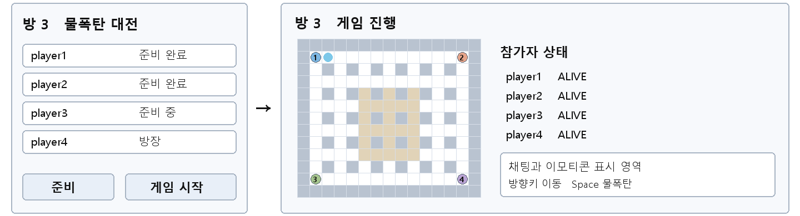

# 네트워크프로그래밍 10주차 개인 주간 보고서

프로젝트: 물폭탄 대전 / 팀: 연결고리 / 작성자: 김동민 / 담당: 서버 게임 로직
작성일: 2026-11-09 / 제출 기한: 2026-11-12 자정

## 이번 주 작업

게임 로직을 맡아 서버가 입력을 받아 게임 상태를 계산하는 부분을 구현했다. 팀에서 정한 메시지 형식을 사용하고, 네트워크 코드와 분리해 먼저 로직을 검사했다.

- GameLoop에 입력 큐를 두고 50ms마다 처리하도록 구성했다. 클라이언트가 보낸 좌표 대신 방향 입력으로 서버에서 이동과 충돌을 계산한다.
- 중심 타일에 물폭탄을 설치하고, 60틱 타이머와 십자 폭발 범위, 상자 파괴, 연쇄 폭발을 구현했다.
- 피격 시 갇힘 상태로 바꾸고 100틱 뒤 탈락시키도록 했다. 같은 틱의 탈락을 모두 처리한 뒤 승리 또는 무승부를 판정한다.
- 기존 공통 API는 유지하고 GAME_INIT, STATE, EVENT, RESULT 등을 생성했다. 네트워크 담당자가 연결할 호출 방법과 미정 사항도 문서로 남겼다.

## 화면 초안

화면 구상용 스케치이며 실제 GUI 구현 결과는 아니다. 클라이언트는 입력과 표시를 맡고, 서버는 이동·충돌·폭발·승패를 판정한다. 접속·방·채팅 중계는 네트워크 담당과 연결한다.

## 검증 결과

| 구분 | 확인 내용 | 결과 |
|---|---|---|
| 맵과 이동·충돌 | 맵 검증, 4인 배치, 방향 유지·정지, 벽·상자 충돌, 빠른 이동 | 5개 통과 |
| 물폭탄과 폭발 | 설치 개수·타이머, 설치 타일 이탈, 폭발 차단, 연쇄, 상자 파괴 | 5개 통과 |
| 탈락과 결과 | 갇힘 시간, 동시 탈락 무승부, 동시 퇴장 | 3개 통과 |
| 통신 연결 경계 | 세션 ID, 입력 검사, 방 분리, 기존 코덱, 게임 스레드 | 5개 통과 |

게임 로직 18개와 기존 프로토콜 테스트를 통과했다. JDK 22에서 `javac --release 17`로 빌드했다. JDK 17 런타임 실행과 실제 4인 통합은 아직 확인하지 않았다.

이번 검증은 게임 로직과 메시지 직렬화에 대한 로컬 테스트다. 네트워크 담당자는 network/dev에서 작업 중이라고 공유했으며, 확인 시점에는 원격에 해당 브랜치가 없어 코드를 비교하거나 실제 방·소켓에 연결하지는 못했다.

## 다음 작업

network/dev가 올라오면 방 시작·입력·퇴장 처리에 GameLoop를 연결하고 클라이언트 4개로 통합 테스트할 예정이다. 이동 속도와 좌표 기준, 폭발 지속 시간, 아이템 코드도 팀원과 확인한다.

아이템 드롭·획득과 플레이어 간 접촉 판정은 미구현이다. 상자 파괴의 `NONE`은 무드롭 임시 값이고, 데모의 4px/틱은 확정 수치가 아니다.

## 응용 계층 프로토콜

전송 프레임은 `[4바이트 길이][UTF-8 본문]`이다. 본문은 `TYPE|roomId|userId|...`이며 서버 방송의 userId는 0이다. 아래 표는 구현한 게임 모듈의 처리 규격이며 실제 소켓 통합은 다음 단계다.

표의 〈맵 195자〉와 ...는 지면상 생략 표기다. 실제 맵 문자열과 출력은 verification.txt에서 확인할 수 있다.

| 기능 | 프로토콜 | 프로토콜 형식 | 실제 예시 | 각 값의 의미 | 전송 방향 | 전송 시점 | 수신 후 처리 |
|---|---|---|---|---|---|---|---|
| 이동 입력 | INPUT | INPUT\|roomId\|userId\|방향 | INPUT\|3\|1\|RIGHT | 3번 방, 1번 사용자, 오른쪽 이동 | 클라이언트 → 서버 | 방향키를 누르거나 뗄 때 | 세션 ID로 입력을 큐에 넣고 틱에서 이동·충돌 판정 |
| 물폭탄 설치 | BOMB | BOMB\|roomId\|userId\| | BOMB\|3\|1\| | 3번 방, 1번 사용자. 본문 없음 | 클라이언트 → 서버 | 설치 키를 누를 때 | 현재 중심 타일·설치 개수 검사 후 폭탄 생성 |
| 게임 초기화 | GAME_INIT | GAME_INIT\|roomId\|0\|맵\|id:x:y,... | GAME_INIT\|3\|0\|〈맵 195자〉\|1:40:40,2:520:40,... | 행 우선 맵과 참가자의 시작 픽셀 좌표 | 서버 → 같은 방 전체 | 게임 루프 시작 시 1회 | 클라이언트가 맵과 캐릭터의 초기 위치를 구성 |
| 상태 갱신 | STATE | STATE\|roomId\|0\|tick\|id:x:y:상태,...\|col:row:남은틱,... | STATE\|3\|0\|1\|1:40:40:ALIVE,...\|1:1:60 | 1틱, 1번 사용자 좌표 40,40, 폭탄 타일 1,1, 남은 60틱 | 서버 → 같은 방 전체 | 매 틱 50ms마다 | 위치·ALIVE/TRAPPED/DEAD·폭탄 타이머를 받은 값으로 표시 |
| 폭발 알림 | EVENT | EVENT\|roomId\|0\|EXPLODE:col:row:상:하:좌:우 | EVENT\|3\|0\|EXPLODE:1:1:0:1:0:1 | 타일 1,1에서 아래·오른쪽 1칸씩 폭발 | 서버 → 같은 방 전체 | 폭탄 설치 후 60틱 또는 연쇄 폭발 | 클라이언트가 실제 판정 범위에 맞춰 폭발 효과를 표시 |
| 상자 파괴 | EVENT | EVENT\|roomId\|0\|BOX_BREAK:col:row:아이템 | EVENT\|3\|0\|BOX_BREAK:2:1:NONE | 타일 2,1 상자 파괴. NONE은 무드롭 임시 값 | 서버 → 같은 방 전체 | 폭발에 상자가 맞았을 때 | 상자를 빈 타일로 변경. 아이템 값은 통합 전 합의 |
| 갇힘 알림 | EVENT | EVENT\|roomId\|0\|TRAPPED:userId | EVENT\|3\|0\|TRAPPED:1 | 1번 사용자가 물방울에 갇힘 | 서버 → 같은 방 전체 | 폭발 틱에 피격됐을 때 | 클라이언트는 갇힘 모션 표시. 서버는 이동·설치 차단 |
| 탈락 알림 | EVENT | EVENT\|roomId\|0\|DEAD:userId | EVENT\|3\|0\|DEAD:1 | 1번 사용자가 탈락 | 서버 → 같은 방 전체 | 갇힌 뒤 100틱이 지났을 때 | 해당 캐릭터를 탈락 상태로 표시 |
| 게임 중 퇴장 | PLAYER_LEFT | PLAYER_LEFT\|roomId\|0\|userId | PLAYER_LEFT\|3\|0\|1 | 3번 방의 1번 사용자가 퇴장 | 서버 → 같은 방 전체 | 네트워크 담당이 playerLeft를 호출한 다음 틱 | 서버는 탈락 처리 후 승패 재판정. 화면은 참가자 상태 갱신 |
| 결과 알림 | RESULT | RESULT\|roomId\|0\|WIN:userId 또는 DRAW:userId,... | RESULT\|3\|0\|WIN:2 RESULT\|3\|0\|DRAW:1,2 | 2번 사용자 승리 또는 1·2번 동시 탈락 무승부 | 서버 → 같은 방 전체 | 틱의 모든 탈락을 적용한 뒤 | 클라이언트는 결과 표시. 로비 담당은 방을 WAIT로 복귀 |

## 작업 근거

- 코드 커밋: https://github.com/midogi/water-bomb-battle/commit/681fef08987b1ebede5dc5034c50bf489ed8055b
- PR: https://github.com/midogi/water-bomb-battle/pull/1
- 검증 출력: [verification.txt](verification.txt)
- 연결 방법: [SERVER_GAME.md](../../SERVER_GAME.md)
- 기준 문서: [개발 규약](../../development-rules.pdf)
